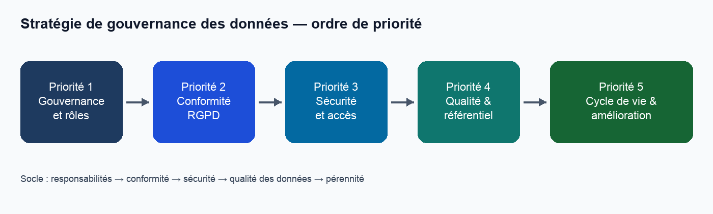

# Stratégie SI

**École :** Livecampus  
**Cours :** Stratégie SI  
**Professeur :** À compléter  
**Livrable :** MINI CAS 1  
**Chapitres couverts :** 1  
**Modalité :** Travail de **groupe**  
**Groupe :** G1  

**Membres du groupe :**
- BADET Mael
- LEBLOND Tristan
- LOURENCO Quentin
- MASIA Antoine

**Format de dépôt attendu :** `STRATEGIE_SI_BADET_LEBLOND_LOURENCO_MASIA_MINI_CAS_1_G1.pdf`

---

## Énoncé du mini-cas

### Contexte

Une entreprise de services financiers rencontre des problèmes liés à la qualité de ses données clients.

Certains doublons existent, les informations ne sont pas toujours à jour, et plusieurs services utilisent des bases de données différentes avec des informations incohérentes.

De plus, la sécurité des données est insuffisante, et l'entreprise fait face à des risques de non-conformité au RGPD.

### Tâche

En tant que responsable de la DSI, proposer des solutions pour mettre en place une stratégie de gouvernance des données afin de résoudre les problèmes mentionnés.

Indiquer les actions recommandées **par ordre de priorité**.

### Livrable attendu

Un document PDF d'aspect professionnel comprenant :

- une page de garde (école, cours, professeur, membres du groupe) ;
- une page reprenant l'énoncé du mini-cas ;
- des pages numérotées avec une présentation claire ;
- des schémas ou illustrations pour appuyer l'analyse.

---

## Analyse du contexte

### Problèmes identifiés

| Problème | Domaine de gouvernance touché | Impact principal |
|----------|-------------------------------|------------------|
| Doublons clients | Qualité des données | Décisions erronées, coûts de traitement |
| Données non à jour | Qualité / cycle de vie | Offres inadaptées, mauvaise relation client |
| Bases hétérogènes et incohérentes | Qualité / propriété / rôles | Silo métier, perte de confiance dans le SI |
| Sécurité insuffisante | Sécurité / accès | Fuites, accès non autorisés |
| Risque RGPD | Conformité réglementaire | Sanctions, litiges, perte de confiance |

L'entreprise dispose d'un SI fragmenté : chaque service « possède » ses données sans référentiel commun. Sans gouvernance, la qualité se dégrade, la sécurité reste faible et la conformité RGPD devient un risque permanent plutôt qu'un processus maîtrisé.

### Objectifs de la stratégie

1. **Fiabiliser** les données clients (exactitude, cohérence, actualité).
2. **Sécuriser** l'accès et le traitement des données personnelles.
3. **Conformiser** les pratiques au RGPD.
4. **Clarifier** les rôles (Data Owners, Data Stewards) et le cycle de vie des données.
5. **Améliorer** l'efficacité opérationnelle en réduisant les silos.

---

## Schéma de la stratégie proposée

La logique est volontairement séquentielle : sans responsabilités claires et sans cadre RGPD/sécurité, un chantier qualité seul créerait un référentiel « propre » mais toujours vulnérable et non conforme.

---

## Actions recommandées par ordre de priorité

### Priorité 1 — Installer la gouvernance et clarifier les rôles

**Pourquoi en premier :** sans propriétaires ni règles communes, toute action technique (nettoyage, outils, sécurité) reste dispersée et non durable.

**Actions :**

1. Créer un **comité de gouvernance des données** (DSI, métiers, conformité / DPO, sécurité).
2. Désigner des **Data Owners** métier pour le domaine « clients » (ex. Direction commerciale / relation client).
3. Nommer des **Data Stewards** opérationnels chargés de la qualité, de la documentation et du suivi des anomalies.
4. Rédiger une **politique de gouvernance des données** : définitions, responsabilités, règles de création / modification / partage.
5. Cartographier les **sources de données clients** (CRM, facturation, support, marketing, etc.).

**Résultat attendu :** un pilotage clair, des responsabilités nommées et une vision partagée du patrimoine de données.

---

### Priorité 2 — Réduire immédiatement le risque de non-conformité RGPD

**Pourquoi ensuite :** l'entreprise est déjà exposée à un risque réglementaire. La conformité ne peut pas attendre la fin du chantier qualité.

**Actions :**

1. Réaliser / mettre à jour le **registre des traitements** portant sur les données clients.
2. Vérifier la **base légale**, les finalités et les durées de conservation de chaque traitement.
3. Lancer une **évaluation d'impact** (AIPD) sur les traitements à risque (profilage, scoring, partage multi-services).
4. Mettre en place les droits des personnes (accès, rectification, effacement, opposition) avec des **procédures opérationnelles**.
5. Sensibiliser et former les équipes (métiers + IT) aux obligations RGPD.
6. Documenter les décisions et les preuves de conformité.

**Résultat attendu :** baisse rapide du risque juridique et réputationnel, cadre documentaire exploitable en cas de contrôle.

---

### Priorité 3 — Renforcer la sécurité des données et la gestion des accès

**Pourquoi maintenant :** qualité et conformité restent fragiles si n'importe qui peut accéder, modifier ou exfiltrer les données.

**Actions :**

1. Appliquer un **contrôle d'accès basé sur les rôles (RBAC)** sur les applications clients.
2. Réaliser une **revue des droits** (suppression des comptes dormants et des privilèges excessifs).
3. Imposer le **chiffrement** des données sensibles au repos et en transit.
4. Activer la **journalisation** des accès et des modifications critiques.
5. Mettre en place une **surveillance / alerting** et un plan de réponse aux incidents de données.
6. Durcir les accès administrateurs (MFA, comptes nominatifs, principe du moindre privilège).

**Résultat attendu :** réduction des fuites et des accès non autorisés ; meilleure traçabilité pour audits et investigations.

---

### Priorité 4 — Traiter la qualité des données et unifier le référentiel client

**Pourquoi à ce stade :** une fois gouvernance, conformité et sécurité posées, on peut industrialiser le nettoyage sans reconstruire le chaos.

**Actions :**

1. Définir des **règles de qualité** (unicité client, formats, champs obligatoires, fraîcheur des données).
2. Mettre en place un **référentiel client unique** (golden record) alimenté par les applications sources.
3. Lancer une campagne de **déduplication** et de **nettoyage** (matching, fusion, historisation).
4. Mettre en œuvre des contrôles de **validation à la saisie** et des contrôles batch récurrents.
5. Organiser la **surveillance continue** de la qualité (indicateurs : taux de doublons, taux de complétude, fraîcheur).
6. Standardiser les dictionnaires de données et les référentiels partagés entre services.

**Résultat attendu :** moins de doublons, données à jour, vision client cohérente pour tous les services.

---

### Priorité 5 — Maîtriser le cycle de vie et ancrer l'amélioration continue

**Pourquoi en dernier levier :** le dispositif doit tenir dans le temps, sinon les doublons et les écarts reviendront.

**Actions :**

1. Formaliser le **cycle de vie** : création → classification → utilisation → archivage → suppression sécurisée.
2. Appliquer des **durées de conservation** alignées RGPD et besoins métier.
3. Automatiser l'archivage et la purge des données obsolètes.
4. Intégrer la gouvernance aux projets SI (revue données / sécurité / conformité avant mise en production).
5. Planifier des **audits périodiques** (qualité, accès, conformité) et un tableau de bord de gouvernance.
6. Améliorer en continu les processus (rétrospectives, correctifs, formation).

**Résultat attendu :** données maintenues, protégées et conformes sur la durée ; réduction durable des coûts de retraitement.

---

## Synthèse de priorisation

| Priorité | Action stratégique | Problème traité en premier | Horizon indicatif |
|----------|--------------------|----------------------------|-------------------|
| **1** | Gouvernance & rôles | Silos, absence de responsabilité | 0–4 semaines |
| **2** | Conformité RGPD | Risque de non-conformité | 0–8 semaines |
| **3** | Sécurité & accès | Sécurité insuffisante | 4–12 semaines |
| **4** | Qualité & référentiel | Doublons, données obsolètes, incohérences | 8–20 semaines |
| **5** | Cycle de vie & pilotage | Durabilité de la gouvernance | Continu |

Les priorités 1 à 3 peuvent démarrer rapidement et en parallèle contrôlée (comité + DPO + RSSI). Le chantier qualité (priorité 4) s'appuie sur ce socle pour éviter de « nettoyer » un système encore non gouverné et non sécurisé.

---

## Bénéfices attendus

- **Réduction des risques** : moins d'erreurs, de fuites et d'expositions RGPD.
- **Meilleure prise de décision** : données clients fiables et à jour.
- **Respect des obligations légales** : traitements documentés, droits des personnes opérationnels.
- **Efficacité opérationnelle** : fin des bases contradictoires, moins de temps perdu à rechercher « la bonne » donnée client.

---

## Conclusion

En tant que DSI, la stratégie recommandée ne consiste pas à « acheter un outil de qualité » en premier, mais à **poser un cadre de gouvernance** : rôles, conformité RGPD, sécurité des accès, puis qualité du référentiel client et maîtrise du cycle de vie.

Cette séquence transforme un SI fragmenté et risqué en un patrimoine de données **fiable, sécurisé et conforme**, au service de la performance commerciale et de la confiance des clients.
