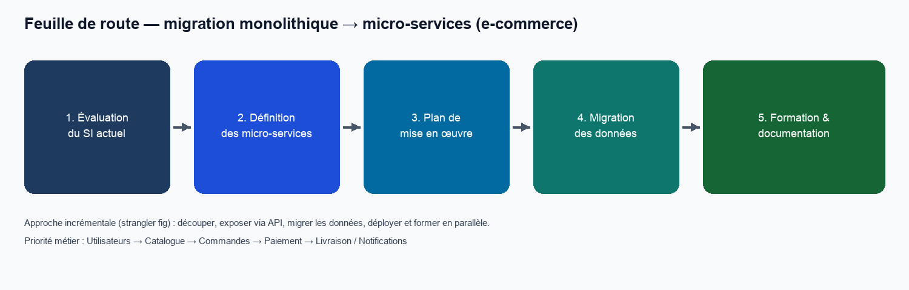

# Stratégie SI

**École :** Livecampus  
**Cours :** Stratégie SI  
**Professeur :** À compléter  
**Livrable :** MINI CAS 3  
**Chapitres couverts :** 3  
**Modalité :** Travail de **groupe**  
**Groupe :** G1  

**Membres du groupe :**
- BADET Mael
- LEBLOND Tristan
- LOURENCO Quentin
- MASIA Antoine

**Format de dépôt attendu :** `STRATEGIE_SI_BADET_LEBLOND_LOURENCO_MASIA_MINI_CAS_3_G1.pdf`

---

## Énoncé du mini-cas

### Contexte

Une société de e-commerce doit faire face à une augmentation rapide de son volume de transactions. Le système d'information (SI) actuel, basé sur une architecture monolithique, n'est pas assez flexible pour s'adapter à cette croissance. L'entreprise souhaite donc migrer vers une architecture micro-services.

### Tâches

Proposer une feuille de route pour migrer le SI vers une architecture micro-services, incluant :

- l'évaluation du SI actuel ;
- la définition des micro-services ;
- le plan de mise en œuvre ;
- la migration des données ;
- la formation et la documentation.

### Livrable attendu

Un document PDF d'aspect professionnel comprenant :

- une page de garde (école, cours, professeur, membres du groupe) ;
- une page reprenant l'énoncé du mini-cas ;
- des pages numérotées avec une présentation claire ;
- des schémas ou illustrations pour appuyer l'analyse.

---

## Vue d'ensemble de la feuille de route

Nous recommandons une migration **incrémentale** (approche *strangler fig*) plutôt qu'un « big bang » : on extrait progressivement des domaines du monolithe, on les expose via des **API**, on bascule le trafic, puis on retire l'ancien code. Cette stratégie limite les risques, préserve la continuité du e-commerce et permet d'apprendre à chaque itération.

---

## 1. Évaluation du SI actuel

### 1.1 Principales fonctionnalités du monolithe

| Domaine | Fonctionnalités typiques | Criticité business |
|---------|--------------------------|--------------------|
| **Utilisateurs / comptes** | Inscription, authentification, profils, préférences | Critique |
| **Catalogue** | Produits, stocks affichés, catégories, recherche | Critique |
| **Commandes** | Panier, validation, suivi de commande | Critique |
| **Paiement** | Autorisation, capture, remboursements | Critique |
| **Livraison** | Transporteurs, tracking, créneaux | Élevée |
| **Marketing / promotions** | Codes promo, recommandations, newsletters | Moyenne |
| **Notifications** | E-mails, SMS, push | Élevée |
| **Reporting / BI** | Tableaux de bord, exports | Moyenne |

### 1.2 Points de faiblesse et goulots d'étranglement

1. **Scalabilité globale contrainte** : pour absorber le pic de transactions, il faut scaler tout le monolithe, même les modules peu sollicités → coûts et complexité inutiles.
2. **Déploiements risqués** : une modification (ex. catalogue) impose de redéployer l'ensemble ; un bug peut impacter commandes et paiement.
3. **Couplage fort** : bases et modules partagés créent des dépendances cachées et freinent les évolutions parallèles des équipes.
4. **Goulots techniques probables** :
   - base de données unique saturée aux heures de pointe ;
   - file d'attente / traitement synchrone des commandes et paiements ;
   - recherche catalogue et gestion des stocks dans le même processus applicatif ;
   - montée en charge difficile du front et du back liés.
5. **Résilience faible** : la panne d'un module peut entraîner l'indisponibilité de tout le site.

### 1.3 Livrables de la phase d'évaluation

- Cartographie applicative et flux (C4 / diagrammes de séquence des parcours critiques : achat, paiement, suivi).
- Mesure des performances actuelles (latence, throughput, erreurs) sur les parcours « panier → paiement → confirmation ».
- Matrice des dépendances données / modules.
- Score de risque par domaine (complexité × criticité × volume).

---

## 2. Définition des micro-services

### 2.1 Services prioritaires (ordre recommandé)

On extrait d'abord les domaines **stables, bien bornés et à fort trafic**, pour démontrer de la valeur rapidement.

| Priorité | Micro-service | Responsabilité | Justification |
|----------|---------------|----------------|---------------|
| **P1** | `user-service` | Comptes, auth, profils | Socle transverse, faible couplage métier |
| **P1** | `catalog-service` | Produits, catégories, recherche | Fort volume lecture, scalable indépendamment |
| **P2** | `order-service` | Panier, commandes, états | Cœur métier e-commerce |
| **P2** | `payment-service` | Paiements, remboursements | Isolation sécurité / conformité |
| **P3** | `inventory-service` | Stocks temps réel | Réduit les surventes sous charge |
| **P3** | `shipping-service` | Expédition, tracking | Intégrations transporteurs |
| **P4** | `notification-service` | E-mails / SMS / push | Asynchrone, découplé |
| **P4** | `promo-service` | Promotions, coupons | Évolutions marketing fréquentes |

### 2.2 Interfaces d'interaction entre services

**Principes :**

- Communication **synchrone** via **API REST** (ou GraphQL pour le BFF front) pour les lectures et actions temps réel.
- Communication **asynchrone** via **bus d'événements** (ex. Kafka / RabbitMQ) pour les effets de bord : `OrderCreated`, `PaymentConfirmed`, `StockReserved`, `ShipmentDispatched`.
- Contrat d'API versionné (`/v1/...`), authentification via **OAuth2 / JWT**, observabilité (logs, traces, métriques).

**Exemples d'interfaces :**

| Producteur | Consommateur | Interface | Type |
|------------|--------------|-----------|------|
| Front / BFF | `user-service` | `POST /v1/auth/login`, `GET /v1/users/{id}` | REST |
| Front / BFF | `catalog-service` | `GET /v1/products`, `GET /v1/products/{id}` | REST |
| Front / BFF | `order-service` | `POST /v1/orders`, `GET /v1/orders/{id}` | REST |
| `order-service` | `payment-service` | `POST /v1/payments` | REST |
| `order-service` | `inventory-service` | événement `StockReservationRequested` | Async |
| `payment-service` | `order-service` | événement `PaymentConfirmed` / `PaymentFailed` | Async |
| `order-service` | `notification-service` | événement `OrderConfirmed` | Async |
| `shipping-service` | `order-service` | événement `ShipmentUpdated` | Async |

**Règle d'or :** chaque micro-service possède sa **propre base de données** (database-per-service). Les échanges de données se font par API ou événements, jamais par jointure SQL transversale.

---

## 3. Plan de mise en œuvre

### 3.1 Calendrier indicatif (6 mois)

| Phase | Période | Objectifs |
|-------|---------|-----------|
| **0. Cadrage** | Semaines 1–2 | Évaluation, backlog, choix techniques (API gateway, bus, CI/CD, observabilité) |
| **1. Fondation** | Semaines 3–6 | API Gateway, authentification, environnements, pipeline CI/CD, monitoring |
| **2. Vague P1** | Semaines 7–12 | `user-service` + `catalog-service` en production (trafic progressif) |
| **3. Vague P2** | Semaines 13–18 | `order-service` + `payment-service` ; bascule du parcours d'achat |
| **4. Vague P3–P4** | Semaines 19–22 | Stocks, livraison, notifications, promotions |
| **5. Décommission** | Semaines 23–26 | Retrait progressif du monolithe, optimisation, run |

### 3.2 Stratégie de déploiement

1. Mettre en place un **API Gateway** devant le monolithe et les nouveaux services.
2. Router progressivement le trafic (canary / feature flags) vers chaque micro-service.
3. Conserver le monolithe comme « shell » tant que des domaines n'ont pas été extraits.
4. Automatiser les déploiements (CI/CD) avec rollback rapide.

### 3.3 Plan de tests

| Type de test | Objectif | Quand |
|--------------|----------|-------|
| **Unitaires** | Logique métier de chaque service | À chaque commit |
| **Contrats d'API** | Compatibilité producteur / consommateur | Avant merge |
| **Intégration** | Parcours multi-services (commande → paiement → stock) | À chaque release candidate |
| **Performance / charge** | Tenir le pic de transactions e-commerce | Avant bascule de trafic |
| **Chaos / résilience** | Vérifier qu'une panne locale n'arrête pas tout le SI | Avant go-live majeur |
| **E2E métier** | Parcours client complet (navigation → paiement → confirmation) | Avant chaque vague |

Critères de go-live d'une vague : SLO respectés (latence, erreur), tests verts, runbook validé, rollback testé.

---

## 4. Migration des données

### 4.1 Principes

- Garantir l'**intégrité** (pas de perte, pas de corruption) et la **cohérence métier** pendant la coexistence monolithe / micro-services.
- Migrer **domaine par domaine**, pas toute la base d'un coup.
- Prévoir une période de **double écriture** ou de **réplication** contrôlée, puis bascule en lecture seule côté monolithe.

### 4.2 Étapes par domaine

1. **Inventaire** des tables / champs du monolithe liés au domaine (ex. commandes).
2. **Modèle cible** du micro-service (schéma dédié, éventuellement dénormalisé).
3. **Scripts ETL / CDC** (Extract Transform Load / Change Data Capture) pour synchroniser monolithe → nouvelle base.
4. **Contrôles d'intégrité** : comptes d'enregistrements, checksums, échantillons métier, rapprochements financiers pour le paiement.
5. **Bascule** : lectures sur le nouveau service, puis écritures, puis arrêt de la synchro.
6. **Archivage** des données historiques selon politique de conservation.

### 4.3 Points d'attention

- Identifiants : stratégie d'**ID stables** (UUID) pour éviter les collisions entre services.
- Transactions distribuées : préférer la **saga** / cohérence éventuelle plutôt que le 2PC.
- Données personnelles : migration conforme **RGPD** (minimisation, chiffrement, droits d'accès).
- Rollback : possibilité de revenir au monolithe tant que la double écriture est active.

---

## 5. Formation et documentation

### 5.1 Formation des équipes techniques

| Public | Contenu | Format |
|--------|---------|--------|
| Développeurs | Design micro-services, API REST/événements, database-per-service | Ateliers + labs |
| Ops / SRE | Conteneurs, orchestration, observabilité, incident response | Workshops |
| QA | Tests de contrats, charge, scénarios E2E | Sessions pratiques |
| Produit / métier | Impacts parcours client, feature flags, priorisation des vagues | Briefings |

### 5.2 Documentation à produire

- Architecture cible (C4, diagrammes de séquence des parcours critiques).
- Catalogue des micro-services et **contrats d'API** (OpenAPI / AsyncAPI).
- Runbooks d'exploitation (déploiement, rollback, incidents).
- Guide de contribution (standards de code, CI/CD, sécurité).
- ADR (Architecture Decision Records) pour les choix structurants.

---

## Synthèse et bénéfices attendus

| Levier (cours ch. 3) | Application dans cette feuille de route |
|----------------------|-----------------------------------------|
| **Évolutivité** | Scaler indépendamment catalogue, commandes, paiement selon le trafic |
| **Résilience** | Isolation des pannes (ex. promo down ≠ site down) |
| **Flexibilité technologique** | Stack adaptée par service (search, paiement, notifications) |
| **API** | Contrats standardisés + gateway pour intégrer front et partenaires |
| **Maintenance** | Déploiements ciblés, équipes autonomes par domaine |

En conclusion, la migration vers les micro-services répond directement au problème du monolithe saturé : elle permet d'absorber la croissance des transactions e-commerce tout en réduisant les risques de déploiement et en améliorant la résilience. La réussite repose moins sur la technologie seule que sur une **feuille de route progressive**, des **contrats d'API clairs**, une **migration de données maîtrisée** et la **montée en compétences** des équipes.
