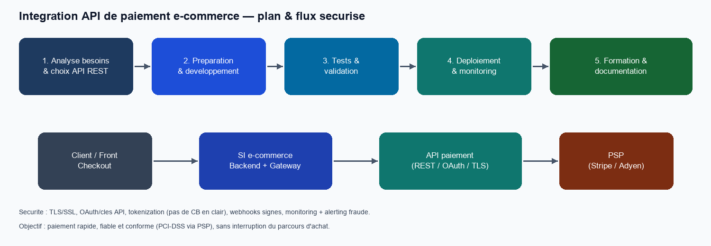

# Stratégie SI

**École :** Livecampus  
**Cours :** Stratégie SI  
**Professeur :** À compléter  
**Livrable :** MINI CAS 5  
**Chapitres couverts :** 5  
**Modalité :** Travail de **groupe**  
**Groupe :** G1  

**Membres du groupe :**
- BADET Mael
- LEBLOND Tristan
- LOURENCO Quentin
- MASIA Antoine

**Format de dépôt attendu :** `STRATEGIE_SI_BADET_LEBLOND_LOURENCO_MASIA_MINI_CAS_5_G1.pdf`

---

## Énoncé du mini-cas

### Contexte

Une entreprise de e-commerce souhaite intégrer une plateforme de paiement en ligne via une API. Cette API permettra aux clients de payer directement sur le site de l'entreprise, et il est crucial de garantir la sécurité des transactions tout en assurant une intégration fluide et fiable. L'objectif est d'offrir une expérience utilisateur optimisée, avec un processus de paiement rapide et sécurisé.

### Tâche

En tant que responsable technique, proposer un plan détaillé pour intégrer la plateforme de paiement : étapes clés, technologies à utiliser et mesures de sécurité pour protéger les données sensibles des clients.

### Livrable attendu

Un document PDF d'aspect professionnel comprenant :

- une page de garde (école, cours, professeur, membres du groupe) ;
- une page reprenant l'énoncé du mini-cas ;
- des pages numérotées avec une présentation claire ;
- des schémas ou illustrations pour appuyer l'analyse.

---

## Vue d'ensemble du plan

L'intégration s'appuie sur les leviers du chapitre 5 : choix d'une **API REST**, **sécurisation des échanges** (TLS, OAuth), **tests / validation**, puis **surveillance et maintenance**. Nous évitons de stocker les numéros de carte : le PSP (Payment Service Provider) gère la tokenisation et la conformité PCI-DSS.

---

## 1. Analyse des besoins et choix de l'API

### 1.1 Besoins de l'entreprise

| Besoin | Exigence cible |
|--------|----------------|
| Volume de transactions | Pic Black Friday / soldes : montée en charge sans timeout checkout |
| Méthodes de paiement | CB (Visa/Mastercard), Apple Pay / Google Pay, éventuellement SEPA |
| International | Multi-devises, 3-D Secure (SCA / DSP2) pour l'Europe |
| UX | Paiement rapide, peu d'étapes, messages d'erreur clairs |
| Fiabilité | Webhooks de confirmation, idempotence, reprise sur incident |
| Conformité | RGPD + non-stockage des données CB (réduction de portée PCI) |

### 1.2 Choix de la technologie : API REST

Conformément au cours, pour une intégration web moderne nous privilégions une **API REST** (HTTP/JSON) plutôt que SOAP :

- simplicité d'intégration avec le front et le backend ;
- bonne interopérabilité et évolutivité ;
- écosystème mature (SDK, webhooks, sandbox).

**SOAP** resterait envisageable uniquement si un partenaire legacy l'imposait ; ce n'est pas le cas ici.

**Exemple de PSP :** Stripe, Adyen ou équivalent européen selon contraintes métier / coûts.

---

## 2. Planification et préparation de l'intégration

### 2.1 Documentation de l'API

Avant de coder, étudier :

- les **endpoints** (`POST /payment_intents`, capture, refund, etc.) ;
- les méthodes HTTP (**POST**, **GET**) et formats de payload ;
- l'authentification (clés secrètes, OAuth) ;
- les **webhooks** de statut (`payment_succeeded`, `payment_failed`) ;
- les codes d'erreur et la politique de retry ;
- l'environnement **sandbox** pour les tests.

### 2.2 Architecture cible

1. Le **front checkout** collecte les infos de paiement via le composant sécurisé du PSP (Elements / Drop-in) → **pas de CB en clair dans notre SI**.
2. Le **backend e-commerce** crée l'intention de paiement via l'API REST (clé secrète côté serveur uniquement).
3. Le client authentifie le paiement (3-D Secure si requis).
4. Le PSP notifie le backend par **webhook signé**.
5. Le backend met à jour la commande (`paid` / `failed`) et déclenche confirmation / livraison.

### 2.3 Calendrier indicatif

| Phase | Durée | Contenu |
|-------|-------|---------|
| Cadrage & choix PSP | 1 semaine | Besoins, contrat, accès sandbox |
| Conception | 1 semaine | Séquences, modèle de données commande/paiement, menaces |
| Coffre-fort credentials web | 3–5 jours | Provisionner le vault, espaces sandbox/prod, droits d'accès |
| Développement | 2–3 semaines | Backend API, checkout, webhooks, idempotence |
| Tests | 1–2 semaines | Intégration, charge, sécurité, parcours E2E |
| Mise en production | 1 semaine | Basculer progressivement, monitoring |
| Hypercare | 2 semaines | Support renforcé, correctifs |

### 2.4 Coffre-fort de credentials web

Les secrets de l'intégration (clé secrète API PSP, secrets de signature webhook, certificats, jetons OAuth) ne doivent **jamais** être stockés en clair dans le code, le dépôt Git ou les fichiers `.env` versionnés.

Nous mettons en place un **coffre-fort de credentials web** (ex. HashiCorp Vault, AWS Secrets Manager, Azure Key Vault, ou le secret store du cloud / de l'hébergeur) avec :

- des espaces séparés **sandbox** et **production** ;
- un accès par **identité applicative** (service account / rôle IAM), pas par mot de passe partagé ;
- une injection des secrets au runtime (CI/CD + runtime du backend) ;
- une journalisation des accès au vault (qui a lu quel secret, quand).

Cette étape est planifiée juste après la conception, pour que le développement consomme déjà les secrets via le coffre-fort et non via des fichiers locaux.

---

## 3. Sécurité des données et des transactions

| Mesure | Mise en œuvre |
|--------|----------------|
| **Chiffrement transit** | TLS 1.2+ / certificats SSL sur tous les échanges |
| **Authentification API** | Clés secrètes côté serveur, OAuth si proposé ; jamais de clé secrète dans le front |
| **Coffre-fort & rotation** | Secrets dans un vault ; rotation périodique et après incident |
| **Tokenization** | Le PSP tokenize la carte ; le SI ne stocke que des références / IDs de paiement |
| **Webhooks** | Vérification de signature ; rejet si invalide |
| **Idempotence** | Clés d'idempotence pour éviter les doubles débits |
| **Moindre privilège** | Comptes / rôles séparés (dev, prod, support) |
| **Journalisation** | Logs sans données sensibles (pas de PAN, pas de CVV) |
| **Audits** | Revue de sécurité + tests de pénétration avant go-live |
| **RGPD** | Minimisation, durées de conservation, droits d'accès sur les données de transaction non CB |

### 3.1 Coffre-fort et rotation des secrets

Le stockage dans un coffre-fort ne suffit pas : les secrets doivent être **rotatés**.

| Secret | Fréquence de rotation | Déclencheur immédiat |
|--------|----------------------|----------------------|
| Clé secrète API PSP (prod) | Tous les 90 jours | Fuite suspectée, départ d'un admin, incident |
| Secret de signature webhook | Tous les 90 jours | Compromise, changement de PSP / endpoint |
| Jetons OAuth / refresh | Selon TTL du fournisseur | Révocation, anomalie d'accès |
| Certificats TLS | Avant expiration (alerte J-30) | Compromission du certificat |

**Processus de rotation :**

1. Générer la nouvelle clé / secret dans le coffre-fort (version N+1).
2. Déployer la double validité si le PSP le permet (ancienne + nouvelle clé pendant une fenêtre courte).
3. Mettre à jour les services (backend, workers webhook) pour lire la nouvelle version.
4. Vérifier les paiements et webhooks en production.
5. Révoquer l'ancienne clé et archiver l'événement de rotation dans les logs d'audit.

Ainsi, même en cas de fuite limitée dans le temps, la fenêtre d'exposition reste courte. La rotation s'intègre aussi à la maintenance continue prévue après le go-live.

Ces mesures reprennent les bonnes pratiques du cours : **sécuriser les échanges**, surveiller les vulnérabilités, et valider les processus critiques avant production.

---

## 4. Tests et validation

| Type de test | Objectif |
|--------------|---------|
| Sandbox fonctionnel | Parcours succès / échec / 3DS / remboursement |
| Contrats d'API | Compatibilité des payloads et codes retour |
| Intégration E2E | Panier → paiement → confirmation commande |
| Charge | Tenir le volume de transactions attendu |
| Sécurité | Signature webhooks, absence de fuite de secrets, headers sécurisés |
| Reprise sur incident | Comportement si PSP timeout / webhook manquant |

**Critères de go-live :** taux d'erreur sous seuil, parcours critiques validés, runbook incident prêt, rollback possible (feature flag checkout).

---

## 5. Déploiement et suivi

### 5.1 Mise en production

- Déployer hors pic d'audience.
- Activer le nouveau paiement via **feature flag** (canary : % de trafic progressif).
- Minimiser les interruptions : l'ancien moyen de paiement reste disponible jusqu'à stabilisation.
- Vérifier les DNS / certificats / variables d'environnement de production.

### 5.2 Surveillance continue

- Monitoring temps réel : taux de succès paiement, latence API, erreurs 4xx/5xx, webhooks en retard.
- Alerting (PagerDuty / e-mail / Slack) sur anomalies et suspicion de fraude.
- Tableaux de bord métier : conversion checkout, paniers abandonnés au paiement.
- Maintenance : mises à jour régulières SDK / API, rotation des clés, revue des accès.

**Exemples de stack de monitoring :**

| Besoin | Outils (exemples) | Usage pour le paiement |
|--------|-------------------|------------------------|
| Métriques & dashboards | **Prometheus + Grafana** | Latence API PSP, taux de succès / échec, saturation CPU/RAM, files webhooks |
| Logs centralisés | **ELK** (Elasticsearch, Logstash/Fluentd, Kibana) ou OpenSearch | Corréler erreurs checkout, codes retour PSP, traces sans données CB |
| Tracing distribué | **Jaeger** / OpenTelemetry | Suivre une transaction panier → backend → PSP → webhook |
| Uptime / synthétique | **Uptime Kuma**, Blackbox Exporter, Pingdom | Sonde périodique du parcours checkout et des endpoints critiques |
| APM applicatif | Datadog, New Relic, Sentry | Exceptions backend, performances des appels API |
| Alerting | Alertmanager (Grafana), PagerDuty, Slack | Seuil d'erreurs 5xx, chute du taux d'autorisation, webhooks en retard |

En pratique, un socle **Prometheus/Grafana** (métriques) + **ELK** (logs) + alertes Slack/PagerDuty couvre déjà l'essentiel pour piloter l'intégration en production.

---

## 6. Formation des équipes et documentation

### 6.1 Formation

- **Support / SAV :** lire un statut de paiement, gérer un remboursement, escalader une fraude.
- **Ops / DSI :** monitoring, rotation des secrets, procédure d'incident PSP.
- **Produit / métier :** impacts UX, méthodes de paiement, reporting.

### 6.2 Documentation technique

- Architecture et diagrammes de séquence.
- Contrats d'API internes + références aux endpoints PSP.
- Procédures d'exploitation (déploiement, rollback, incident).
- Matrice des responsabilités (qui peut rembourser, qui gère les clés).

---

## Synthèse

| Étape (guide du mini-cas) | Notre réponse |
|---------------------------|---------------|
| Analyse des besoins & choix API | REST + PSP tokenisé, multi-moyens, international / 3DS |
| Planification & préparation | Doc API, architecture, calendrier en phases |
| Sécurité | TLS, OAuth/clés serveur, tokenization, webhooks signés, audits |
| Déploiement & suivi | Canary, monitoring, alerting, maintenance |
| Formation & documentation | Support + ops formés, doc technique complète |

En conclusion, l'intégration réussie d'une API de paiement repose moins sur « brancher un endpoint » que sur une **planification complète** : besoins clairs, technologie adaptée (REST), **sécurité native** (ne jamais traiter la CB en clair), tests robustes, mise en production progressive et pilotage continu. C'est exactement l'approche du chapitre 5 pour intégrer un tiers dans le SI de façon **sécurisée, évolutive et maintenable**.
